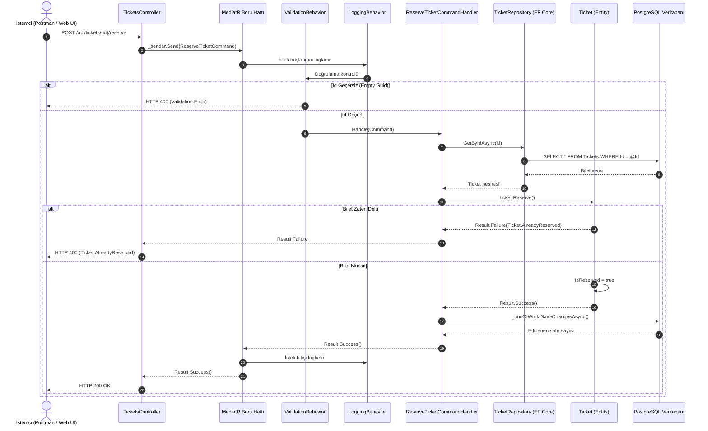

# TicketingApp - Mimari ve Tasarım Rehberi Raporu

**Proje:** `TicketingApp`  
**Platform:** .NET 10 (C# 13)  
**Mimari Yaklaşım:** Clean Architecture (Onion/Hexagonal), CQRS, Domain-Driven Design (DDD) Primitifleri  
**Tarih:** 21 Ekim 2026  

---

## 1. Giriş ve Büyük Resim

`TicketingApp`, modern kurumsal backend mimarilerini ve en iyi geliştirme pratiklerini sergilemek amacıyla tasarlanmış bir **Bilet Rezervasyon Sistemi**dir.

Projede geleneksel, tüm mantığın controller veya servis katmanına yığıldığı "monolitik/spagetti" yapı yerine; her katmanın tek bir sorumluluğu olduğu **Clean Architecture (Temiz Mimari)** benimsenmiştir.

### Temel Mimari Kural (The Dependency Rule)
Katmanlar iç içe geçmiş halkalar gibidir. **Bağımlılık oku daima dışarıdan içeriye (merkeze) bakar:**
- **Domain** (En iç katman): Hiçbir katmana ve harici kütüphaneye bağımlı değildir.
- **Application**: Sadece Domain'i bilir.
- **Infrastructure**: Application ve Domain sözleşmelerini implemente eder.
- **Api** (En dış katman): Dış dünyadan gelen HTTP isteklerini Application katmanına aktarır.

```
 [ İstemciler / Web / Postman ]
               │
               ▼
 ╔══════════════════════════════════════════════════╗
 ║ 1. TicketingApp.Api                              ║
 ║    - TicketsController, Program.cs, Swagger      ║
 ╚══════════════════════════════════════════════════╝
               │
               ▼
 ╔══════════════════════════════════════════════════╗
 ║ 2. TicketingApp.Application                      ║
 ║    - CQRS (Commands & Queries)                   ║
 ║    - MediatR Handlers & Pipeline Behaviors       ║
 ║    - FluentValidation, Arayüz Sözleşmeleri       ║
 ╚══════════════════════════════════════════════════╝
        │                                  │
        ▼ (İş Kuralı)                      ▼ (Sözleşme Sağlayıcı)
 ╔═════════════════════════════╗    ╔══════════════════════════════════╗
 ║ 3. TicketingApp.Domain      ║    ║ 4. TicketingApp.Infrastructure   ║
 ║    - Ticket (Entity)        ║◄───║    - ApplicationDbContext (EF)   ║
 ║    - SeatNumber (VO)        ║    ║    - TicketRepository            ║
 ║    - Result, Error, Entity  ║    ║    - SqlConnectionFactory (Dapper║
 ╚═════════════════════════════╝    ╚══════════════════════════════════╝
```

---

## 2. Katmanların Ayrıntılı Görev Dağılımı

### 2.1. Domain Katmanı (`TicketingApp.Domain`)
İş kurallarının (Business Rules) ve verinin özünün korunduğu çekirdektir.

- **Rich Domain Model (Zengin Model):**
  - `Ticket.cs`: Rezervasyon durumu ve koltuk bilgisi `private set` ile korunur. `Reserve()` metodu ile iş kuralı işletilir.
  - `Event.cs`: Etkinlik adı, lokasyonu ve tarih aralıkları korunur. `Create()` fabrika metodu ile tarih ve ad doğrulanır; `Cancel()` metodu ile etkinlik iptal edilir.
- **Değer Nesneleri (Value Objects):** `SeatNumber.cs`, `record` olarak tanımlanmıştır. Format kurallarını (boş olmama, 5 karakteri geçmeme) kendi içerisinde doğrular; bu sayede primitive obsession (ilkel tip takıntısı) engellenir.
- **Result Pattern:** İş kurallarında veya doğrulamalarda `Exception` fırlatılmaz; `Result`, `Result<T>` ve `Error` nesneleri ile öngörülebilir ve hızlı bir dönüş sağlanır.

### 2.2. Application Katmanı (`TicketingApp.Application`)
Kullanım senaryolarını (Use Cases) organize eder.

- **CQRS Ayrımı:**
  - **Commands (Yazma):**
    - `ReserveTicketCommand` & `ReserveTicketCommandHandler`: Domain iş mantığını ve Unit of Work'ü çalıştırır.
    - `CreateEventCommand` & `CreateEventCommandHandler`: Yeni etkinlik oluşturur ve veritabanına ekler.
  - **Queries (Okuma):**
    - `GetTicketByIdQuery` & `GetTicketByIdQueryHandler`: Dapper ile salt-okunur bilet DTO'su (`TicketResponse`) döner.
    - `GetEventByIdQuery` & `GetEventByIdQueryHandler`: Dapper ile etkinlik detay DTO'su (`EventResponse`) döner.
    - `GetEventsQuery` & `GetEventsQueryHandler`: Dapper ile tüm etkinlik listesini döner.
- **Cross-Cutting Concerns (Boru Hattı Filtreleri - `Application/Behaviors`):**
  - `LoggingBehavior<TRequest, TResponse>`: Her isteğin başlangıç ve bitişini otomatik loglar.
  - `ValidationBehavior<TRequest, TResponse>`: İstek handler'a ulaşmadan önce FluentValidation kurallarını çalıştırır, geçersizse isteği kesip `Result.Failure` döner.
- **Arayüz Sözleşmeleri (Abstractions & Repositories):**
  - `ITicketRepository`: Bilet veri erişim arayüzü.
  - `IEventRepository`: Etkinlik veri erişim arayüzü.
  - `IUnitOfWork`: Değişiklikleri tek bir işlemde veritabanına kaydetme sözleşmesi.
  - `ISqlConnectionFactory`: Dapper için veritabanı bağlantısı üretme sözleşmesi.

### 2.3. Infrastructure Katmanı (`TicketingApp.Infrastructure`)
Veritabanı, dosya sistemleri ve dış servislerle konuşan altyapıdır.

- **EF Core Entegrasyonu:** `ApplicationDbContext` hem EF DbContext'tir hem de `IUnitOfWork` sözleşmesini karşılar (`Tickets` ve `Events` DbSet'leri).
- **Fluent Mapping:** 
  - `TicketConfiguration.cs`: `SeatNumber` değer nesnesini `HasConversion` ile string'e dönüştürür.
  - `EventConfiguration.cs`: Etkinlik tablosunu, kısıtlarını ve maksimum uzunluklarını yapılandırır.
- **PostgreSQL & Dapper:** `SqlConnectionFactory`, `NpgsqlConnection` oluşturur.

### 2.4. Presentation / API Katmanı (`TicketingApp.Api`)
Kullanıcı veya istemcilerin sisteme girdiği kapıdır.

- **İnce Kontrolörler (Thin Controllers):**
  - `TicketsController`: Bilet sorgulama ve rezervasyon işlemleri.
  - `EventsController`: Etkinlik oluşturma (`POST /api/events`), tekil getirme (`GET /api/events/{id}`) ve listeleme (`GET /api/events`).
- **Temiz `Program.cs`:** Her katman kendi servislerini `AddApplication()` ve `AddInfrastructure()` extension metotları ile yükler; `Program.cs` karmaşadan uzaktır.

### 2.5. Test Katmanı (`TicketingApp.Domain.UnitTests`)
Clean Architecture kurallarına göre birim testler Domain katmanından ayrı bir test projesinde tutulur:
- `TicketTests.cs`: Bilet iş kuralları testi.
- `EventTests.cs`: Etkinlik oluşturma, tarih kontrolü ve iptal kuralları testi.

---

## 3. Uçtan Uca Bir İsteğin Hayat Döngüsü

Bir istemci `POST /api/tickets/{id}/reserve` adresine istek attığında sistem şu adımları izler:



---

## 4. Kullanılan Tasarım Desenleri Özeti

| Desen / Prensip | Nerede Uygulandı? | Neden Kullanıldı? |
| :--- | :--- | :--- |
| **Clean Architecture & DIP** | Katmanlar arası arayüzler (`ITicketRepository`, `IUnitOfWork`, `ISqlConnectionFactory`) | Üst seviye modüllerin alt seviye detaylara (SQL, EF Core) bağımlı olmaması için. |
| **CQRS** | `ReserveTicketCommand` vs `GetTicketByIdQuery` | Yazma işleminde Domain güvenliği, okuma işleminde ise Dapper ile maksimum hız sağlamak için. |
| **Result Pattern** | `Result`, `Result<T>`, `Error` | Beklenen iş mantığı sonuçlarında pahalı `Exception` fırlatmayı önlemek için. |
| **Mediator & Pipeline (AOP)** | MediatR, `LoggingBehavior`, `ValidationBehavior` | Controller ile Handler arasındaki bağı koparmak, loglama ve validasyonu tek merkezden yönetmek için. |
| **Value Object** | `SeatNumber` | Koltuk formatı doğrulama kurallarını tek bir yerde toplamak ve değişmezliği garanti etmek için. |
| **Repository & Unit of Work** | `TicketRepository`, `ApplicationDbContext` | Veritabanı işlemlerini soyutlamak ve transaction bütünlüğünü korumak için. |

---

## 5. Proje Dosya Haritası

```
clean/
├── TicketingApp.slnx                                   # Çözüm dosyası (5 proje)
│
├── TicketingApp.Domain/                                # Çekirdek İş Kuralları
│   ├── Entities/
│   │   └── Ticket.cs                                   # Bilet Entity (Rich Domain Model)
│   ├── Primitives/
│   │   ├── Entity.cs                                   # Temel Entity sınıfı
│   │   ├── Error.cs                                    # Standart Hata tanımı
│   │   └── Result.cs                                   # Result & Result<T> pattern
│   └── ValueObjects/
│       └── SeatNumber.cs                               # Koltuk numarası Değer Nesnesi
│
├── TicketingApp.Application/                           # Kullanım Senaryoları (Use Cases)
│   ├── Data/
│   │   └── ISqlConnectionFactory.cs                    # Dapper bağlantı arayüzü
│   ├── Repositories/
│   │   ├── ITicketRepository.cs                        # Bilet depo arayüzü
│   │   └── IUnitOfWork.cs                              # Değişiklikleri kaydetme arayüzü
│   ├── Tickets/
│   │   ├── Behaviors/
│   │   │   ├── LoggingBehavior.cs                      # Log boru hattı
│   │   │   └── ValidationBehavior.cs                   # Doğrulama boru hattı
│   │   ├── GetTicket/
│   │   │   ├── GetTicketByIdQuery.cs                   # Sorgu modeli ve DTO
│   │   │   └── GetTicketByIdQueryHandler.cs            # Dapper ile hızlı okuma
│   │   └── ReserveTicket/
│   │       ├── ReserveTicketCommand.cs                 # Komut modeli
│   │       ├── ReserveTicketCommandHandler.cs          # Komut iş mantığı
│   │       └── ReserveTicketCommandValidator.cs        # FluentValidation kuralları
│   └── DependencyInjection.cs                          # Application servis kayıtları
│
├── TicketingApp.Infrastructure/                        # Dış Dünya / Veritabanı
│   ├── Data/
│   │   └── SqlConnectionFactory.cs                     # Npgsql bağlantı üreticisi
│   ├── Database/
│   │   ├── ApplicationDbContext.cs                     # EF Core DbContext & IUnitOfWork
│   │   └── Configurations/
│   │       └── TicketConfiguration.cs                  # Fluent API Entity ayarları
│   ├── Repositories/
│   │   └── TicketRepository.cs                         # ITicketRepository implementasyonu
│   └── DependencyInjection.cs                          # Infrastructure servis kayıtları
│
├── TicketingApp.Api/                                   # Sunum / REST API
│   ├── Controllers/
│   │   └── TicketsController.cs                        # HTTP Uç Noktaları (GET & POST)
│   ├── appsettings.json                                # Bağlantı dizesi ve ayarlar
│   └── Program.cs                                      # Sadeleştirilmiş başlangıç noktası
│
└── TicketingApp.Domain.UnitTests/                      # Birim Testler
    └── Tickets/
        └── TicketTests.cs                              # Domain iş kuralı testleri (xUnit)
```

---

## 6. Yeni Başlayanlar İçin Geliştirme İpuçları

1. **Yeni bir özellik eklerken sırayı takip edin:**
   - Önce **Domain**: Entity ve iş kurallarını tanımlayın.
   - Sonra **Application**: Command veya Query, Handler ve Validator yazın.
   - Sonra **Infrastructure**: Gerekli tablo eşlemesi (Configuration) veya Repository metodunu ekleyin.
   - En son **Api**: Controller içine yeni `_sender.Send(...)` çağrısı ekleyin.
2. **Entity'lerde `public set` kullanmayın:** Veri her zaman bir iş metodunun onayından geçerek değişmelidir.
3. **Repository'leri sadece Command'larda kullanın:** Veri sadece okunacaksa Dapper ile Query yazmak mimari açıdan en verimli yoldur.
